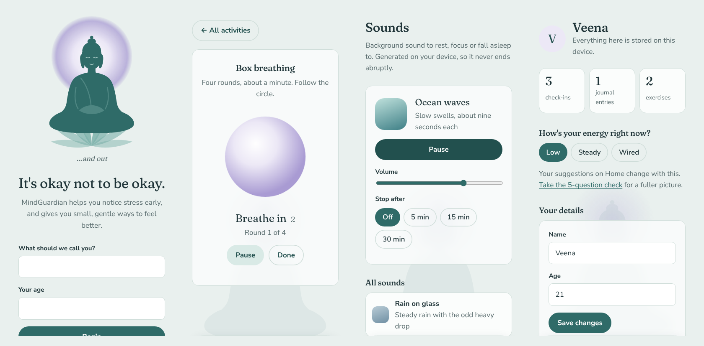

# MindGuardian

**A gentle companion that helps you notice stress early and feel better, a little at a time.**

### 👉 [Open the live app: veenashanmukh.github.io/mindGaurdian](https://veenashanmukh.github.io/mindGaurdian/)

No account needed. Everything you enter stays on your own device.


## What you can do

- **Check in with yourself.** Tap Low, Steady or Wired, or take the 5-question check. Home adjusts its suggestions to how you're doing.
- **A calm space.** A seated Buddha on a lotus greets you, with a halo that slowly breathes in and out, and rests softly behind every page.
- **Calm down in a minute or two.** Box breathing with a breathing orb, a quiet timer with a soft chime, 5-4-3-2-1 grounding, progressive muscle relaxation, mindful colouring and calm tapping.
- **Voice check-in.** Speak for a few seconds; MindGuardian reads the tone of your voice (not the words) on your device and suggests what might help.
- **Background sounds.** Rain, ocean waves, a forest morning and soft piano, generated live in the browser, with volume and a stop-after timer.
- **Journal and reflect.** Write freely, or answer five guided questions and get a short, kind summary. Add a sentence before bed to close the day.
- **See your week.** A 7-day mood outlook built from your check-ins and writing.
- **Your profile, your data.** Edit your details, turn permissions on or off, see past entries, or clear everything in one tap.



## Built with

React 19 · Vite · React Router · Web Audio API · Firebase (optional) · GitHub Pages

## Run it locally

```bash
cd frontend
npm install
npm run dev
```

Then open the address Vite prints (it ends in `/mindGaurdian/`).

## Deployment

Every push to `main` builds the app and publishes it to GitHub Pages automatically, using `.github/workflows/deploy.yml`.

## Privacy

Your name, check-ins, journal entries and settings are saved in your browser's local storage on this device only. Voice recordings are analysed in the browser. Clearing your data from the Profile page removes everything.

---

Made by **[Veena Shanmukh](https://github.com/veenashanmukh)**, with Prarthana and Pradeep M Doddakaragi.
