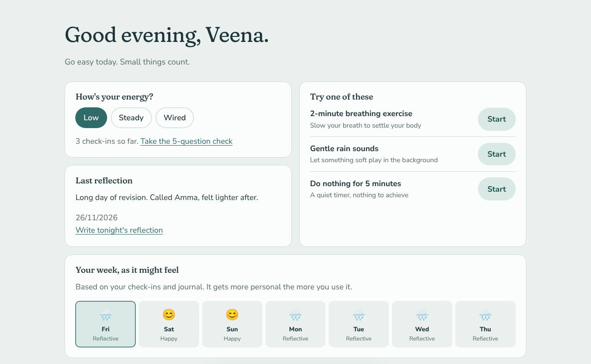
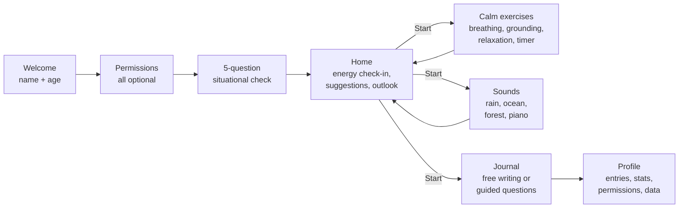

# MindGuardian

**A calm web app that helps students and young adults notice stress early and feel better, with quick check-ins, guided calming exercises, soothing sounds and a private journal.**

### 👉 [Open the live app: veenashanmukh.github.io/mindGaurdian](https://veenashanmukh.github.io/mindGaurdian/)

No account needed. Everything you enter stays on your own device.



## The problem

Stress among students and young adults builds up quietly, through exams, deadlines, screen time and poor sleep, until it turns into burnout or anxiety. Most people:

- **Don't notice the early signs.** There's no habit of checking in with how they feel.
- **Don't know what to do in the moment.** Breathing or grounding techniques help, but nobody has them to hand at 1 am before an exam.
- **Avoid apps that feel clinical,** ask for an account, or send private feelings to a server.
- **Find most wellness apps loud and overwhelming** at exactly the moment they need calm.

## Our solution

**MindGuardian** is a gentle, private companion that fits into a few minutes of the day:

1. **Notice.** A 10-second energy check-in (Low, Steady, Wired), a 5-question situational check, or a voice check-in that reads the tone of your voice.
2. **Act.** Home suggests three small things to try based on how you're doing, and each one opens directly: box breathing, grounding, muscle relaxation, a quiet timer, calming sounds or journaling.
3. **Reflect.** Write freely or answer guided questions, get a short and kind summary, and close the day with a one-line reflection.
4. **See patterns.** A 7-day mood outlook built from your own check-ins and writing.

It's designed to feel calm: soft sea-glass colours, a meditating Buddha on a lotus, and a halo that slowly breathes in and out. It's also private by design: everything is stored in your browser, and nothing personal is uploaded.

> MindGuardian helps with everyday stress. It is **not** a medical device and doesn't diagnose or treat anything. If you're struggling, please talk to someone you trust or a professional. In India, **Tele-MANAS** offers free, 24×7 mental-health support on **14416** or **1-800-891-4416**.

## How someone uses it



## Features

| Area | What you can do |
|---|---|
| **Check-ins** | Tap Low, Steady or Wired; take the 5-question situational check; or record a voice check-in |
| **Calm exercises** | Box breathing (four rounds of 4-4-4-4) with a breathing orb, quiet timer (1–10 min) with a soft chime, 5-4-3-2-1 grounding, progressive muscle relaxation, mindful colouring, calm tapping |
| **Sounds** | Rain on glass, ocean waves, forest morning and soft piano, with volume control and a stop-after timer (5, 15 or 30 min) |
| **Journal** | Write freely, or answer five guided questions and get a short summary with one suggested next step |
| **Reflection** | One line before bed, with a quick read of how your words sound |
| **Home** | Greeting by name, suggestions that change with your energy, a 7-day mood outlook, your last reflection |
| **Profile** | Edit name and age, turn permissions on or off, see your stats, journal entries and recent exercises, clear all data |
| **Calm space** | A seated Buddha on a lotus greets you, and rests faintly behind every page |


## Tech stack

| Layer | Technology | Used for |
|---|---|---|
| UI framework | **React 19** | Components and state |
| Build tool | **Vite 7** | Dev server and production build |
| Routing | **React Router 7** (`BrowserRouter` with `basename`) | Pages under `/mindGaurdian/` on GitHub Pages |
| State and storage | React Context + **`localStorage`** | Remembers your profile, check-ins and journal on your device |
| Voice | **MediaRecorder API** + **Web Audio API** | Records the voice check-in and analyses it in the browser |
| Sounds | **Web Audio API** (noise, filters, oscillators, delay) | Generates the four soundscapes live, so no audio files are needed |
| Notifications | **Notification API** | Optional gentle reminders |
| Optional cloud | **Firebase** (Analytics; Auth and Firestore on the optional `/auth` page) | Anonymous usage events; account sign-in if enabled |
| Styling | Plain CSS with custom properties | Calm theme, **Fraunces** and **Nunito Sans** fonts, SVG illustration |
| Hosting | **GitHub Pages** via **GitHub Actions** | Builds and deploys on every push to `main` |

## How the smart parts work (technical)

**Voice check-in.** The browser records your voice with `MediaRecorder`. `logic/audioTone.js` decodes the audio, splits it into frames of 1,024 samples, and measures two signals in each frame:

- **RMS (root mean square):** how loud and energetic the voice is.
- **Zero-crossing rate:** how often the waveform crosses zero, a rough measure of pitch and agitation.

The averages are compared with thresholds. Very quiet speech counts as *calm*, loud or high zero-crossing speech as *tense*, and anything in between as *neutral*. If you sound tense, the app offers a breathing round. The recording never leaves your device.

**Text tone (Reflection).** `services/mlkitService.js` scores your text from 0 (calm) to 1 (tense). It starts at 0.5, adds for stress words like *anxious*, *overwhelmed* or *panic*, and subtracts for calm words like *grateful* or *relaxed*. It also picks out stress topics such as *deadline*, *sleep* or *argument*, and suggests naming one small thing you can do about them.

**Journal summary.** The guided answers are checked for five mood groups: bright spots, heaviness, stress, calm and gratitude. The app writes a short summary that names what it noticed, acknowledges how you handled the hard parts, and offers one next step.

**Personalised suggestions.** `logic/personalization.js` maps your latest energy to three suggestions. Each one carries a link that opens the exercise directly, for example `/activities?game=breathing` or `/music?track=rain`:

| Energy | Suggestions |
|---|---|
| Low | Breathing, rain sounds, a quiet timer |
| Steady | Muscle relaxation, guided questions, colouring |
| Wired | A focus session, grounding, journaling |

**7-day outlook.** `logic/forecastInference.js` looks at your last 14 check-ins (voice and energy) and your last 10 journal entries and reflections. It finds your most common recent mood and lays out the week around it. It reflects your own patterns; it isn't a prediction.

**Soundscapes.** `services/ambient.js` builds each sound from scratch:

- **Rain:** filtered pink noise, plus short pitched "drops".
- **Ocean:** brown noise with a slow 9-second swell.
- **Forest:** soft wind, plus randomised bird chirps.
- **Piano:** pentatonic notes with a gentle echo.

Every sound fades in and out, so nothing starts or stops abruptly.

**Box breathing.** A one-second timer drives four phases of four seconds (in, hold, out, rest) for four rounds. The orb scales with a CSS transition that lasts exactly one phase, so it grows and shrinks in time with the counts.

## Data and privacy

All your data is one JSON object saved in your browser's `localStorage` under the key `mg_user_state`:

```text
name, age, energy
permissions   { notifications, voice, screenTime, wearable }
checkIns      [{ kind: energy | quiz | voice, value, date }]
journals      [{ date, mode: write | qa, content, summary, moods }]
reflections   [{ date, text, energy }]
activityLog   [{ type, title, date }]
```

- Voice recordings and journal text are **never uploaded**.
- **Clear my data** on the Profile page deletes everything.
- Firebase Analytics, when it loads, records only anonymous events such as "onboarding completed".

## Project structure

```
mindGaurdian/
├── .github/workflows/deploy.yml   # Build and deploy to GitHub Pages
├── docs/                          # README screenshots
└── frontend/
    ├── index.html                 # Fonts, title, favicon
    ├── vite.config.js             # base: '/mindGaurdian/'
    └── src/
        ├── App.jsx                # Routes and bottom navigation
        ├── index.css              # Calm theme: colours, type, components
        ├── context/UserContext.jsx        # State + localStorage
        ├── pages/                 # Onboarding, Permissions, SituationalCheck,
        │                          # DashboardNew, ActivitiesNew, Music, Journal,
        │                          # Reflection, Profile, AuthPage
        ├── components/
        │   ├── games/             # Breathing, Grounding, PMR, Colouring, Timer, Calm tapping
        │   ├── dashboard/         # Suggestions
        │   └── BuddhaFigure.jsx   # Original Buddha-on-lotus illustration
        ├── logic/                 # audioTone, personalization, forecastInference
        └── services/              # ambient (sounds), mlkitService (text tone),
                                   # firebase, analytics, notifications
```

## Run it locally

You need **Node.js 20** or newer.

```bash
cd frontend
npm install
npm run dev
```

Open the address Vite prints. It ends in `/mindGaurdian/`.

## Deployment

Every push to `main` runs `.github/workflows/deploy.yml`, which:

1. Installs dependencies with `npm ci` and builds with `npm run build`.
2. Copies `index.html` to `404.html`, so links like `/mindGaurdian/dashboard` work when opened directly or refreshed.
3. Publishes `frontend/dist` to GitHub Pages.

One-time setup in the repo: **Settings → Pages → Source: GitHub Actions**.

## Limitations and next steps

- **The tone analysis uses simple signal measurements and word lists**, not a trained model. Training a small model on labelled voice and text, for example with TensorFlow.js (already a dependency, not yet used), would make it more accurate.
- **Your data lives in one browser.** Optional sign-in with sync would help people who switch between phone and laptop.
- **Wearable data is simulated** in this version.

---

Made by **[Veena Shanmukh](https://github.com/veenashanmukh)**, with Prarthana and Pradeep M Doddakaragi.
